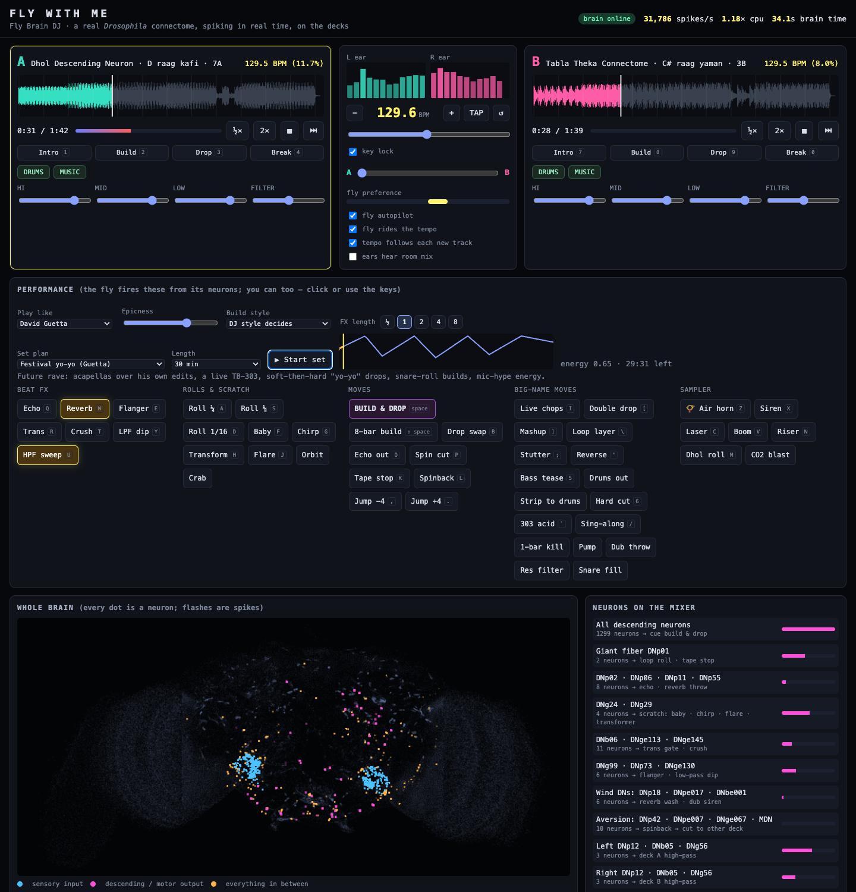
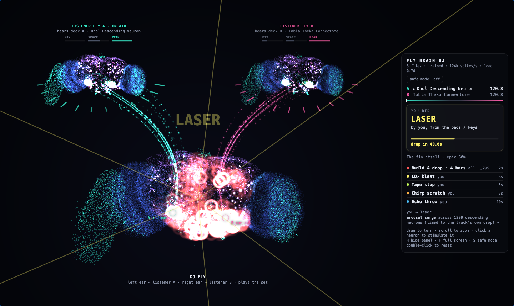

# Fly With Me

**The whole fruit-fly connectome, simulated in real time, performs a DJ set.**



The complete adult *Drosophila* connectome (FlyWire v783: **138,639 neurons, 15,091,983 connections**) runs as a
spiking network on your computer. Three simulated flies play together: a listener fly on each deck, and a DJ fly that
hears the two listeners. Music drives the flies' auditory neurons. The DJ fly's descending and motor neurons play a
synth and work a two-deck mixer: scratches, builds and drops, stems, 29 big-name DJ styles, set planning, key lock.

It's a model, not a living fly, and the DJ craft around the neurons is designed: see
[what the fly decides and what's designed](#what-the-fly-decides-and-whats-designed).

> ⚠️ **Photosensitivity.** The visualiser flashes in time with the music. It opens behind a warning, and *safe mode*
> (the default if your system asks for reduced motion) keeps every change of light slow, with no strobes, inverts or
> shakes. **Volume:** the app starts at −6 dB and fades in; a ceiling at about −1 dBFS is last in the chain.

## Quick start

```bash
git clone https://github.com/izntariq/fly-with-me.git && cd fly-with-me
uv venv --python 3.12 .venv && uv pip install -r requirements.lock.txt
#   (without uv: python3.12 -m venv .venv && .venv/bin/pip install -r requirements.lock.txt)
./run.sh            # first run downloads the FlyWire data (~210 MB), starts the brain, opens http://localhost:8765
```

Press **Start the fly**. A crate of 8 synthesized demo tracks (4 desi, 4 club techno) is ready right away. Drop your
own audio files anywhere on the page to add them to the crate. Tempo, key, style and an energy curve are measured in
the browser; the beat grid and song structure come from the optional song analysis when it's installed
(`scripts/setup_allin1.sh`, Apple silicon; see [Where the fly is in a track](#where-the-fly-is-in-a-track)).

`run.sh` takes `PORT=…`, `NO_BROWSER=1` and any server flag (`--flies 1`, `--cpu`, `--brain naive`,
`--connectome malecns`). The first start also builds a 123 MB connectome cache (about 10 s).

### Requirements

- **Python 3.12+** (3.12.7 tested). `requirements.txt` gives compatible ranges, `requirements.lock.txt` the exact
  tested set.
- git, curl, and a modern browser: Safari, Chrome, Edge or Firefox. The app is used in Safari and tested in headless
  Chrome.
- **Disk:** about 1.2 GB (the environment ~670 MB, the FlyWire model ~370 MB, annotations 32 MB, the cache 123 MB).
  Optional song analysis: about 1.6 GB more. Optional male CNS: 1.1 GB download plus a 207 MB cache.
- Node 18+ and Chrome only for the developer tools in `tools/`.

| Platform | Brain runs on | Status |
|---|---|---|
| macOS 14+, Apple silicon | GPU (MLX Metal kernels) | Tested (M3 Pro): three flies use about a third of each 20 ms frame |
| Linux, Intel Mac | CPU (Numba), automatic when MLX is missing | Not re-measured since Audit 4's refractory fix. Three flies need a process each; on 4–8 cores use `./run.sh --flies 1` |
| Windows | — | Untested; use WSL2 and open the printed address in your Windows browser |

The song analysis (`.venv-allin1`) needs Apple silicon, since its stem separation runs through MLX. Elsewhere, dropped
tracks keep the browser's beat grid and the listener flies' section sense.

## What the fly decides, and what's designed

| From the simulated connectome | Designed (code in this repo) | From elsewhere |
|---|---|---|
| Which neurons fire, when and how hard, for a given sound, taste or wind input | Which neuron groups trigger which DJ move (the giant fiber could as well have been the echo) | Beat grid and song structure of analysed tracks: the All-In-One analyzer |
| The pathways: ear → giant fiber, ear laterality, bitter → aversion neurons, sugar → motor neurons | Burst detection, cooldowns, the pace target, epicness | The 29 DJ styles: interpretations of published interviews and sets ([DJ_RESEARCH.md](docs/DJ_RESEARCH.md)) |
| When moves happen (bursts), which variant plays (the cell type leading the burst), which transition style (the most excited group), which deck it turns toward and at which section boundary it leaves a track (steering) | Ear habituation, which makes the fly want the other deck: computed in the browser, the simulation has no adaptation | |
| The next track: how strongly and in what pattern each candidate excites its listener fly, against the track on air, with the DJ fly's arousal deciding between similar and different | The DJ craft: phrase alignment, planned exits, bass swaps, builds, harmonic mixing, tempo journeys | |
| 9,978 synapses changed by training (0.07% of connections) | The thresholds that turn these signals into decisions, and the rule that an aroused fly picks the similar track. *Neurons decide more* off: designed rules for exits, picks and variants | |
| | The section model: a classifier fitted on the listener flies' neurons | |

Measured honestly: the training doesn't measurably help the fly sense song sections, and a classifier on its neurons
does no better than one on its own ear input ([TRAINING.md](docs/TRAINING.md), [AUDIT.md](docs/AUDIT.md)). Treat the
fly as the performer and the source of taste, not as a structure detector. [NOTES.md §5](docs/NOTES.md) has the full
split.

## Documentation

| For | Doc | What's in it |
|---|---|---|
| Everyone | [`docs/NOTES.md`](docs/NOTES.md) | How every part works, the neuroscience, measured findings, design decisions, limitations, testing, ideas |
| Everyone | [`docs/DJ_RESEARCH.md`](docs/DJ_RESEARCH.md) | How 29 big-name DJs play live, what each finding became in the app, and all sources |
| Contributors | [`CONTRIBUTING.md`](CONTRIBUTING.md) | Setup, checks, the data policy, how to send changes |
| Contributors | [`docs/TRAINING.md`](docs/TRAINING.md) | How some of the fly's synapses were trained, the section sense built on its neurons, and what the measurements say |
| History | [`docs/CHANGELOG.md`](docs/CHANGELOG.md) | Every version from the first line of code |
| History | [`docs/AUDIT.md`](docs/AUDIT.md) | Five audits: findings, fixes and corrections to earlier claims. Read its summary first: early sections were later revised |
| History | [`docs/GIT.md`](docs/GIT.md) | How this history is organised, and how to browse, compare and run any version |

## What's actually happening

```
 deck A track ──► listener fly A: both ears, 12 JO bands ──┐ 12 tapped descending-neuron types each
 deck B track ──► listener fly B: both ears, 12 JO bands ──┤
                                                           ▼
 🍬 / 🍋 / wind ──────────────────────────────────► DJ fly: left ear ◄ listener A, right ear ◄ listener B
                                                           │ 1,409 descending + motor neurons
            crossfader ◄── left vs right descending neurons (the fly "turns toward" a deck)
            beat roll  ◄── DNp01 giant fiber (the escape-jump neuron)
            echo throw ◄── DNp02 / DNp06 / DNp11 / DNp55
            aversion   ◄── bitter-driven DNp42 / DNpe007 / DNge067, MDN "moonwalker": a low-pass dip, then a spinback exit
            filters    ◄── DNp12 / DNb05 / DNg56 (low-frequency hearing pathway), per side
            fly synth  ◄── every DN/MN is a key; motor neurons play bass, DNs play lead
```

* **Three flies** (`--flies 3`, the default).
  * Each listener fly hears its deck's raw track (before the DJ's EQ, filters and effects) in both ears. That's how
    the trained synapses were trained: one track in both ears.
  * The DJ fly hears the listeners. Twelve descending-neuron types of listener A drive the 12 bands of its left ear,
    and listener B's drive its right ear (`LISTENER_TAPS` in `flybrain/server.py`; the first six are the section
    readout's neurons, five of them trained).
  * The DJ fly performs: moves, transitions, the synth. Taste and wind go to it too.
  * `--flies 1` runs a single fly with deck A in its left ear and deck B in its right; `--flies 2` runs the two
    listeners only, and the on-air deck's listener performs.
* **The brain** uses the same model and parameters as Shiu et al., *Nature* 2024
  ([repo](https://github.com/philshiu/Drosophila_brain_model)): leaky integrate-and-fire neurons, synaptic weight =
  synapse count × neurotransmitter sign × 0.275 mV, 1.8 ms delay, 2.2 ms refractory period, and Poisson drive for
  sensory input.
  * **On the GPU** (the default on Apple silicon): `flybrain/gpu.py` steps all three flies together with custom MLX
    Metal kernels. A 20 ms frame for 3 flies takes about 6.5 ms.
  * **On the CPU** (`--cpu`): `flybrain/brain.py`, a Numba rewrite with exact exponential integration, each fly in its
    own worker process. One fly on 12 threads runs about 4× faster than real time on an M3 Pro, instead of minutes
    per second in Brian2.
  * **Validation:** the paper's sugar-neuron experiment (21 sugar GRNs at 200 Hz; the paper reports about 400
    active neurons). On the CPU it gave 406 active neurons and 20.1k spikes in 1 s, with feeding motor neurons firing.
    That was before Audit 4's refractory fix; since the fix the GPU gives 386–392 active neurons and 18.8k–19.5k spikes
    (3 seeds). The CPU hasn't been re-measured.
* **Trained synapses.** By default (`--brain auto`) every fly loads `brains/trained_brain.npz`: 9,978 synapses onto
  25 descending neurons, trained so those neurons fire in particular parts of a track. Everything else is the FlyWire
  wiring. `--brain naive` runs the untouched connectome, without the section model or the readout (both exist only
  for the trained brain), so on tracks without an analysis the fly has no section sense. Measured fairly, the training
  doesn't measurably help the fly sense song sections: see [`docs/TRAINING.md`](docs/TRAINING.md).
* **Inputs and outputs** (`flybrain/mapping.py`) are picked by cell type from the FlyWire annotations
  (Schlegel et al. 2024). JO-B neurons respond to low-frequency sound and JO-A to higher frequencies. Spreading
  individual subtypes across 12 frequency bands is an artistic tonotopy, not a measured one.
* **Findings that shaped the design:**
  * Loud high-frequency sound drives JO-A, which fires the **giant fiber** (DNp01), the fly's escape command neuron.
    That's a real circuit, so it became the "beat roll" move.
  * The ears are strongly lateralized: right-ear drive gives ~30× more right-side DN spikes than left-side ones.
    So the DJ fly's left ear carries deck A, its right ear deck B, and it steers the crossfader toward the side it
    responds to more (phonotaxis).
  * **Olfactory input sends the model into self-sustaining runaway** (~800k spikes/s in the antennal lobe), so smell
    isn't wired in. The server auto-resets a fly if any input causes runaway.
* **Why the fly changes tracks.** It *wants* to leave when its left/right preference points to the other deck and its
  ear on the on-air deck has habituated (over ~75 s, tracked in `web/js/ears.js`). It stays on each track at least
  45 s (a slider). Then:
  * on an analysed track it mixes out at the planned exit (the outro, or about 12 bars before the end) unless its
    neurons choose an earlier one: any section boundary in the second half of the track is an exit the DJ fly takes
    if its steering neurons have kept turning toward the other deck (held over ~8 s, decided 4 bars ahead, landing
    exactly on the boundary). After 4 minutes on air at the latest. With *neurons decide more* off, it leaves early
    only from a breakdown in the last 40% of the track, if it wants to
  * on other tracks it waits for an outro its listener fly senses or, if it wants to leave, a confident breakdown in
    the last 30% of the track; failing those, 4 minutes on air or the track ending
  * the off-air deck is restocked from the crate and beat-matched. A deck whose track was on air for 10 s or more gets a
    new one when it leaves the air, so the track just played can't be cued again

## Where the fly is in a track

**Analysed tracks.** The server looks up a track's beat grid and song structure by the audio file's SHA-1
(`GET /analysis/<sha1>`).
- The author's library of tracks was analysed offline (those analyses aren't distributed, so the benchmark figures
  in the docs can't be reproduced from a clone) by the All-In-One structure analyzer (Kim & Nam 2023, trained on the
  human-annotated Harmonix Set), with its Demucs stem separator running on the GPU through MLX (~28 s a track).
- An unknown dropped file is uploaded and analysed in the background, one at a time, if the analyzer's environment
  (`.venv-allin1`) is installed.
- The app fits a bar grid to the analysed downbeats and maps intro / verse / chorus / break / outro onto every bar
  (`applyAnalysis` in `web/js/tracks.js`). Hot cues go on real section starts. Each downbeat is numbered from the last
  one on the grid, so a stray or half-bar downbeat can't shift the rest. A track whose tempo or bar line moves is
  fitted on its end, where it's mixed out of. Over the library's 499 analyses the app applies 494 grids, 390 of them
  steady (measured in commit 1fb7f0e).
- It plans each track's exit (`mixBar`): a blend across an outro of 10+ bars, an echo out of a short outro as the last
  chorus ends, or a blend from about 12 bars before the end. Tracks without a steady 4/4 grid (the tempo or the bar
  line moves, or the bar isn't 4 beats) are cut, echoed or spun out of, never blended.

**Other tracks.** Each listener fly has a section sense (`web/js/sections.js`):
- Per bar, its 518 output-neuron types are pooled into rates, log-scaled and normalised against the track so far,
  plus the last 4 bars and the app's own per-bar energy.
- A logistic classifier turns those into intro / verse / chorus / break / outro, and an online HMM keeps the sections
  in order, weighted by how far into the track the deck is.
- The model (`brains/sections_trained.json`) was fitted on 107 of 131 recorded real tracks against All-In-One labels.

The structure comes from the analyzer or the classifier, not from the fly's judgement. The fly is the performer:
its neurons decide when to act, which move and which variant of it, which transition style, when to leave a track
(among the analysis's section boundaries) and which track comes next. The *neurons decide more* toggle turns the
last three back into designed rules, for comparison.

## DJ moves

Modelled on what headline DJs actually do: Carl Cox's cue builds (roll the same cue point with shrinking loop
lengths, then slam into the drop), Richie Hawtin's FX-as-an-instrument, turntablist scratches (Qbert, Jazzy Jeff,
A-Trak), and desi-set staples (air horn, dhol roll, siren). The fly fires them from neuron bursts; you can fire them
too with the pads or the keyboard. Everything is quantized to the beat.

| Group | Moves (key) |
|---|---|
| Beat FX | echo `Q`, reverb `W`, flanger `E`, trans gate `R`, bit-crush `T`, low-pass dip `Y`, high-pass sweep `U` (length: FX length buttons) |
| Rolls & scratch | loop roll ¼ `A` / ⅛ `S` / 1/16 `D`, baby `F`, chirp `G`, transformer `H`, flare `J`, orbit, crab (Qbert) |
| Moves | **build & drop** `space` (⇧ = 8 bars), drop swap `B`, echo out `O`, spinback cut `P`, tape stop `K`, spinback `L`, beat jump `,` `.` |
| Big-name moves | live chops `I` (Fred again..), double drop `[`, mashup `]`, loop layer `\` (Hawtin), stutter `;` (Skrillex), reverse `'`, bass tease `5`, hard cut `6`, 303 acid `` ` `` (Guetta), sing-along `/`, 1-bar kill (Fisher), pump (Alok), dub throw, resonant filter (Model 1), Pryda snare fill |
| Sampler | air horn `Z`, dub siren `X`, laser `C`, boom `V`, riser `N`, dhol roll `M`, CO2 blast |
| Hot cues | deck A `1`–`4`, deck B `7`–`0` (intro / build / drop / break: on an analysed track, the intro, 8 bars before the first chorus, the first chorus and the first break after it; on a demo track, its fixed arrangement; otherwise estimated from the energy) |
| Tempo | master BPM slider, `-` / `=` or the numpad's − / + (⇧ for 0.1), TAP, ↺ back to the track's tempo; both decks follow and stay phase-locked; **key lock** keeps the pitch |
| Stems | DRUMS / MUSIC mute per deck; drums out, strip to drums pads |
| Set | set plan + length + Start set; 🎤 fly MC; 📝 Export set |

**Play like…** Pick one of 29 DJ styles from the research, among them David Guetta, Martin Garrix, Tiësto, Calvin
Harris, Swedish House Mafia, DJ Snake, Skrillex, Diplo, Steve Aoki, Armin van Buuren, Alok, Nucleya, Fred again..,
Carl Cox, Richie Hawtin, Charlotte de Witte, Amelie Lens, Peggy Gou, Black Coffee, Solomun, Four Tet, Jamie xx,
Eric Prydz, Fisher, John Summit, Kaytranada, DJ Qbert, A-Trak and DJ Jazzy Jeff. The fly's neurons still decide *when*
and *how hard*; the style decides *what*: which moves each neuron group reaches for, which transitions (Fisher's 1-bar
kill, Skrillex's hard cuts, Black Coffee's 32-bar blends…), which build (snare roll, cue roll, stutter, filter), how
long a track stays on (Kaytranada 25–60 s, Tiësto 1–2 min), its home tempo and its crowd hype. The fly's own minimum
time on air (45 s by default) wins when it's longer than a style's. **Build style** can override the build. The
styles are interpretations of the research, not recordings of anyone's set; see
[`docs/DJ_RESEARCH.md`](docs/DJ_RESEARCH.md).

**Stems.** Every track has a drums stem and a music stem. The demo tracks are rendered that way. A file you drop in
is split when it's loaded on a deck (not when it's dropped), in a background worker, by harmonic–percussive separation.
That takes about 5 s for a 90 s track, and the two stems add back up to the original exactly. Tracks over 12 minutes
get no stems (the separation would need gigabytes). Each deck has **DRUMS** / **MUSIC** mutes. The fly uses them for
*drums out* (Nucleya's dhol drop-out, Calvin Harris and Fred again.. sing-alongs), *strip to drums* (Hawtin, Carl
Cox), acapella-style mashups (the other deck's music stem) and percussion layering.

**Set planner.** Pick an energy arc and a length: club night, warm-up, peak time, Guetta's festival yo-yo, Diplo's
pop → heavy → pop, Kaytranada's beat tape, or a closing set. Then press **Start set**. The fly's epicness follows the
arc, it picks tracks whose intensity matches where the arc is heading, the tempo leans with it, and it builds into
the peaks and breaks down in the dips. A graph shows the plan, where you are, and how hard the fly actually played.

**The fly on the mic.** With **🎤 fly MC** on (it's off by default), it shouts hype through the browser's speech voice: "Are you ready?"
in builds, a shout on the drop, "Balle balle!" on desi tracks, and each DJ style's own lines. Its spikes pick the
phrase. Styles whose DJs don't talk on the mic stay quiet. The MC is heard live but not captured by *Record set*.

**Export set.** **📝 Export set** (also automatic when a recording stops) downloads a markdown report: style, plan,
the tracklist with when and how each track came in, counts of what the fly did, and the full event log.

**Key lock.** Like a CDJ's *master tempo*: with **key lock** on, tempo changes don't change pitch. Each deck runs
through a real-time WSOLA pitch shifter (an AudioWorklet, the method behind SoundTouch). A 440 Hz tone stays at
440.1 Hz at +12% and at −10%, and drum hits stay as tight as unprocessed.
With key lock on, DJ styles can move the tempo up to 20% and the fly can blend tracks up to 16% apart.

**Track selection.** When the off-air deck needs a new record, the fly previews up to 3 candidates in its cue ear
(5 s each, from their drop, like a DJ in headphones). It scores each by how hard the descending neurons of that
deck's listener fly fire, and by the pattern: which descending cell types fire, against that listener's baseline,
compared with the on-air track's pattern. An aroused DJ fly (its descending population above its slow baseline)
favours the candidate that excites its listener most like the track on air; a calm one favours the most different.
It discounts tracks it has already played, favours harmonic neighbours and close tempos, and loads the winner. Scores show in the crate (🎧). It doesn't audition in the on-air track's last 90 s unless the other
deck is empty. A deck whose track was just on air is restocked anyway: auditioned if the on-air track has more than
30 s left, otherwise loaded straight from the crate. Turn autopilot off and it goes back to crate order.

**Adapting to new music.** Every track you drop in is analysed in the browser for tempo (with a double-time check
for drum & bass), key (Krumhansl profiles → Camelot code), style (club / hip-hop / drum & bass / chill / desi — desi
is recognised from the file name) and an energy curve per bar. When the song analysis knows the track, its beat grid
replaces the browser's. The fly then:
- plays its voice in the track's key (and switches to dhol + sitar for desi),
- changes its move set with the style: hip-hop → scratches instead of builds, chill → reverb/echo instead of chops,
  drum & bass → fast rolls,
- reaches for space (echo, reverb, flanger) in breakdowns and lets a drop breathe for 8 bars,
- times arousal builds so they land exactly on the track's own drop,
- cuts (echo out / spinback) instead of blending when tempos are far apart, and snaps or drifts the master tempo to
  each new track ("tempo follows each new track"),
- favours next tracks that are harmonic neighbours (Camelot ±1) and within 6% tempo.

For tracks without an analysis, tempo detection is a heuristic: if a deck shows half or double the real BPM, hit
**½×** / **2×** on the deck. They're greyed out on analysed tracks, whose grid, sections and exit come from the
analysis.

**The fly as DJ.**
- **Moves** come from bursts in named neuron groups (the table is in [`docs/NOTES.md`](docs/NOTES.md)). They wait in
  a short queue and go out on the bar grid: a slot every bar in verses and choruses, every 2 bars elsewhere, released
  so they land on the line.
- **Pace:** a moves-per-minute target (default 8) slowly adapts the burst threshold. The strongest bursts still pick
  the moves.
- **Fit:** moves are swapped for ones that suit the section (filters and space in intros and outros, space in
  breakdowns). Within a family (echo / reverb / dub, trans / crush / stutter …) the cell type that led the burst picks
the variant, never the same one twice in a row. With the default style, now and then a strong burst in a chorus
  plays a big move (live chops, bass tease or drums out, pump, acid, sing-along).
- **Transitions** land on 16-beat phrase lines, or on an analysed track's planned exit bar. Each style starts early by
  its own lead, so its cut or drop lands on the line. The style comes from whichever neuron group is most excited:
  giant fiber → drop swap, echo group → echo out, aversion → spinback cut, calm → a long EQ blend with bass swap.
  Blends and cuts bring the incoming track in from its first bar.
- **Builds:** a surge across all ~1,300 descending neurons triggers a cue build & drop.
- **Tempo:** with *fly rides the tempo* on, arousal moves the BPM by up to ±6%. The tempo holds still while a
  transition is lined up, and while a move has cuts or restores scheduled on the audio clock (builds, double drops,
  mashups, drums out…); the tempo fader and the glide wait too. Changing the tempo yourself ends any hold. With
  *tempo follows each new track*, a cut snaps the tempo to the new track on the beat it lands, by the audio clock.
- **Epicness** scales how often and how hard it plays.

## Controls

| Control | What it does |
|---|---|
| **fly autopilot** | Off = you DJ and the fly just sings. Touching any EQ/filter or the crossfader overrides the fly (double-click a knob to hand it back). |
| **moves per minute** | The pace the fly aims for (2–20, default 8). Every move is still triggered by its neurons, on bar lines. |
| **stay on a track at least** | The minimum time on air before the fly mixes out (15–120 s, default 45 s), unless the track runs out. |
| **ears hear room mix** | With `--flies 1`: the fly hears the master output instead of split cue, including its own synth (a feedback loop). With two or three flies the listeners always hear their own deck's raw track, and the toggle is disabled. |
| 🍬 Sugar / 🍋 Bitter | 3 s of taste stimulation. Sugar fires feeding motor neurons, so the fly "sings" louder. Bitter fires aversion neurons: the fly dips a low-pass filter and, once past its minimum time on air, wants off the track, which it leaves at the next fitting place with a spinback. |
| Wind | Drives the JO-C/E wind & gravity neurons. |
| Fly voice | Level, quantize-to-beat (off = raw spike timing), scale, **MIDI out** (lead on ch 1, bass on ch 2) to drive any hardware or DAW synth. The browser asks for MIDI access only when you open the MIDI-out menu. |
| volume | Your listening level (default −6 dB, remembered). Recordings are taken before it, at full mix level. |
| keyboard shortcuts | Single-key shortcuts on or off (remembered). They never fire while a button, field or menu has focus. |
| 🎤 fly MC | The fly shouts hype through the browser's speech voice. Off by default. |
| Record set | Records the master output to a `.webm` download. |

The whole brain view shows the performing fly as a frontal projection of every neuron: blue = sensory inputs,
magenta = outputs, orange = everything in between. The raster shows all 1,409 output neurons over the last 4 s.

## The whole CNS: male brain + nerve cord

```bash
./run.sh --connectome malecns      # downloads ~1.1 GB on first use
```

This swaps in the male central nervous system connectome (Janelia male-cns v1.0, 2026, CC-BY 4.0): 165,122 neurons
and 25.6M connections across the brain, optic lobes and ventral nerve cord. The descending neurons now reach the
fly's real leg, wing and haltere motor neurons (708 of them), and those motor neurons join the outputs.

It runs the same model. Signs come from each neuron's predicted transmitter (GABA and glutamate inhibit), and synapse
counts are scaled by 0.52 to match FlyWire's input per neuron. Driving the whole sugar channel at 200 Hz
(`tools/cnscheck.py`; a much bigger stimulus than the paper's 21 neurons), both connectomes gave 263k spikes/s and
about 10.2k (FlyWire) and 10.3k (male CNS) active neurons, and the male CNS fires the feeding motor neurons (MN9). That
was measured before the refractory fix. Cell types share FlyWire's names, so the ears, the DJ moves and the listener
taps carry over.

The brain runs untrained: the learned synapses, the section readout and the section model exist only for FlyWire. It
costs about 40% more GPU time than FlyWire (server load 0.44 vs 0.31 for three flies, measured side by side when it
was added, commit f248899). See `flybrain/malecns.py`.

## Visualiser



**🧠 Visualiser** (top right of the app) opens `viz.html` in its own window, so you can put it on a second screen. It
shows each fly's whole brain in 3D, at the real FlyWire position of every neuron and coloured by class. Every spike lights
up as it happens (up to 2,400 a frame across the flies; above that, a random sample).

With three flies, the two listener flies sit on top, each with its MIX / SPACE / PEAK sense meters. Their tapped descending
neurons stream into the DJ fly's left and right ears. These are the same taps the server wires into its ear bands.

A small panel on the side shows:
- the move being made, and the neurons whose burst fired it (they ring in the brain, with a line from the card)
- the transition queued for the next phrase, with a countdown
- the countdown to a drop
- the recent moves and the decks

The background flashes each move's colour, and each move has its own look, timed to the beat. Transitions and drops
send a shockwave through the brain. It opens behind a photosensitivity warning; **safe mode** (the panel button or
**S**) smooths every change of light and colour to well under 3 per second and drops inverts, shakes and strobes. Drag turns the brains, the wheel zooms, hovering an output neuron names it, and
clicking it stimulates that cell type in that fly for 0.9 s. Keys: **H** hides the panel, **F** goes full screen.

Brain activity comes straight from the brain server. The moves, decks and beat come from the DJ app over a
`BroadcastChannel`, so open the visualiser from the app, in the same browser. If the server comes back with another
brain (other flies, the other connectome), the visualiser reloads and the DJ page shows a reload banner. If the GPU
drops the visualiser's WebGL context, it waits and reloads when the context comes back.

## Layout

```
flybrain/brain.py     the Shiu et al. LIF model on the CPU (Numba): dense and event-driven kernels
flybrain/gpu.py       the same model on the GPU (Apple silicon, MLX Metal kernels), all flies stepped together
flybrain/mapping.py   sensory inputs / DN+MN outputs from FlyWire annotations; neuron positions
flybrain/malecns.py   the whole male CNS connectome (brain + nerve cord) as an alternative to FlyWire
flybrain/server.py    aiohttp server: runs the flies in real time, streams spikes over WebSocket, serves song analyses
flybrain/ears.py      Python port of the app's ears, for training and recording
flybrain/train.py     synapse training (fit / online methods, split-ear option)
flybrain/sections.py  section sense: reference labels, per-bar features, classifier, learned arrangement
web/index.html        the DJ app;  web/viz.html  the visualiser
web/js/main.js        wiring: connection, crate, song analysis, control loop, UI, keyboard, tempo, visualiser feed
web/js/visualiser.js  viz.html: 3D brains (WebGL2), spikes, listener → DJ fly streams, move effects
web/js/decks.js       two decks: EQ, filter, rolls, scratching, brake, hot cues, scheduled jumps; crossfader; master bus
web/js/fx.js          master FX rack (sweeps, trans, crush, flanger, reverb) + sampler (horn, siren, boom…)
web/js/perform.js     DJ moves shared by fly and human: cue build & drop, drop swap, echo out, spin cut…
web/js/flydj.js       neurons → DJ decisions: moves, pace, transitions, exits, track picking, listener senses
web/js/sections.js    section sense in the browser, one per listener fly
web/js/djstyles.js    29 "play like" DJ styles from the research
web/js/setplan.js     energy arcs for a whole set, track intensity
web/js/mc.js          the fly on the mic (speech synthesis)
web/js/stems-worker.js drums / music separation for dropped tracks (web worker)
web/js/keylock-worklet.js key-lock pitch shifter (AudioWorklet)
web/js/ears.js        audio spectrum → Johnston's organ drive, per deck for the listener flies; habituation
web/js/synth.js       neurons → notes (club synth, or dhol + sitar) + MIDI out
web/js/tracks.js      club demo tracks, BPM/beat detection, hot cues; the analysed grid, sections and exit plan
web/js/desi.js        desi demo tracks: dhol, tabla, dholak, tumbi, sitar, tanpura, harmonium
web/js/analysis.js    key / Camelot, style and energy analysis of new music
web/js/viz.js         brain map, raster, ears, waveforms
brains/               trained synapses, section readout, section model, training logs (CC BY-NC 4.0, see brains/README.md)
tests/                Python unit tests (unittest) and the section-sense golden fixture
scripts/setup_allin1.sh  sets up the optional song-analysis environment (.venv-allin1)
requirements*.txt     the app's dependencies (ranges, and the tested lock); the song analysis's
LICENSE, NOTICE, CITATION.cff, CONTRIBUTING.md, SECURITY.md   licence, attributions, citation, contributing, security
experiments/readout.py how brains/readout.json was built
tools/                benchmarks and tests (djbench, livetest, test_decks, gpucheck…), recording, section training,
                      song analysis (All-In-One, Demucs on MLX)
docs/                 notes, training, audits, research, changelog, git explainer
vendor/               Shiu et al. model + FlyWire v783 connectivity (cloned by run.sh)
data/                 annotations, caches, real tracks and their analyses (downloaded / generated, not in git)
```

## Tests

Everything here runs without the connectome download and takes seconds.

```bash
.venv/bin/python -m unittest discover -s tests -v   # LIF core, CPU/GPU parity, section sense, mapping, the server's guards
cd tools && npm ci && npm test               # DJ decisions, section-sense parity between Python and the browser
```

- `tests/test_lif.py` runs the Numba model on hand-built networks: exact integration against the closed-form PSP,
  spike / reset / refractory, synaptic delay, Poisson drive, event vs dense kernel.
- `tests/test_gpu_parity.py` (Apple silicon with MLX; skipped elsewhere) checks the Metal kernels give the CPU's spikes
  exactly under deterministic drive and the same statistics under Poisson drive. GPU runs aren't bit-reproducible
  (float atomics in the synapse scatter), so never write exact-count tests against them.
- `tools/test_sections_parity.mjs` checks the browser's section sense gives the Python posteriors on a golden fixture
  (`tests/fixtures/sections_golden.json`; regenerate with `python tests/fixtures/make_sections_golden.py` only when the
  model is meant to change).
- `tools/test_dj_logic.mjs` runs the app's own Mixer, Performer and FlyDJ on a stand-in for Web Audio.

GitHub Actions runs the Node tests and syntax checks, the Python tests on Linux, and again on macOS for the GPU path.
Heavier checks (the full app headless, benchmarks) are in `tools/` and [NOTES.md §13](docs/NOTES.md); they need a
server on a spare port: `.venv/bin/python -m flybrain.server --port 8766`, and the tools default to `PORT=8766`.

## Security and LAN mode

By default the server listens on 127.0.0.1 only. Every request must name this machine in its Host header (and in
Origin when a page sends one), so other websites can't reach it, including through DNS rebinding.

**LAN mode** (play from a phone or tablet): `python -m flybrain.server --host 0.0.0.0`. The server makes a random
access token and prints the address to open, e.g. `http://192.168.1.5:8765/?t=Xy3…`. Open that link once on each
device; it sets a cookie, so later loads, uploads and the visualiser window work without it. `FLYBRAIN_TOKEN=…` keeps
the same token across restarts. On the machine running the server, `http://localhost:8765` needs no token.

**LAN traffic is plain HTTP.** Anyone who can watch your network can read the token and the audio you upload, and
anyone with the link can drive the flies, poke neurons and upload files. Use LAN mode only on a network you trust.
Requests from this machine itself need no token, so a tunnel or reverse proxy on it (ssh -R, cloudflared,
`tailscale serve`) would let its remote users in without one: don't put one in front of the server.

**Your files:** a track you drop in is played in the browser. If the song analysis is installed and the server doesn't
know the track, the file is copied to `data/uploads/` on the server, analysed, and deleted. Nothing leaves your
machine (or your LAN, in LAN mode); the app loads no CDNs, fonts or analytics.

**Limits:** 16 pages connected at once; an analysis queue of 20 tracks and 4 GB (when it's full the page keeps its own
beat grid); 400 MB per upload, saved only under audio extensions. Report vulnerabilities as described in
[SECURITY.md](SECURITY.md).

## Troubleshooting

- *"missing vendor/Drosophila_brain_model/… / data/neuron_annotations.tsv: run ./run.sh"*: the data wasn't
  downloaded. Run `./run.sh`; it resumes cleanly after an interrupted download.
- *"missing the server's packages"* or an old Python: create `.venv` as in [Quick start](#quick-start). `run.sh`
  prefers `.venv/bin/python` over `python3`.
- *"the annotations download has SHA-256 …"*: the pinned file changed upstream or the download was corrupted. Nothing
  was saved; try again, and open an issue if it persists.
- *No browser opened*: open the printed address yourself (Linux needs `xdg-open`).
- *No sound*: the browser needs a click first (press **Start the fly**); if audio was suspended, a *tap to resume*
  button appears. Check the *volume* slider.
- *Slow or choppy on the CPU*: `./run.sh --flies 1`, and close other heavy tabs. The header shows the brain's load.
- *The visualiser is blank*: answer its photosensitivity warning; it needs WebGL2.
- *Dropped tracks get no analysed grid*: the song analysis is optional (`scripts/setup_allin1.sh`, Apple silicon).

## Contributing

See [CONTRIBUTING.md](CONTRIBUTING.md). In short: run the tests above, never commit FlyWire data, audio or analyses of
real tracks, and test on a spare port (8766), never against a server someone is using.

## Licence and citations

The code is Apache-2.0 ([LICENSE](LICENSE)). The trained brain files in `brains/` are derived from FlyWire and are
**CC BY-NC 4.0**, not Apache-2.0: non-commercial use, with attribution to FlyWire ([brains/README.md](brains/README.md),
[NOTICE](NOTICE)). The FlyWire connectome and annotations that `run.sh` downloads are also CC BY-NC 4.0; the optional
male CNS connectome is CC BY 4.0. The optional song analysis is installed by you and not redistributed; madmom's model
files in it are CC BY-NC-SA 4.0. To cite this project, see [CITATION.cff](CITATION.cff).

Data: FlyWire connectome (Dorkenwald et al. 2024, Schlegel et al. 2024, *Nature*; annotation release ≥3.0 also
Matsliah et al. 2024 and Berg et al. 2025). Male CNS: male-cns v1.0, Janelia FlyEM (https://male-cns.janelia.org).
Model: Shiu et al. 2024, *Nature*. Song structure: All-In-One (Kim & Nam 2023, IEEE WASPAA).
